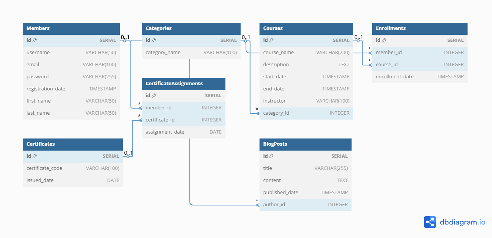

# 🚀 TurkStudentCo - Comprehensive SQL Assignments and Online Education Platform Database Architecture

Welcome to our project! 🎉

This repository contains a collection of SQL assignments prepared as part of the **TurkStudentCo SQL Training Program**, with a particular focus on a detailed **PostgreSQL-based Online Education Platform Database Architecture**.

The goal is to develop a professional understanding of database design and management, progressing from beginner-level concepts to advanced scenarios.

This project is the result of a comprehensive analysis and collaborative effort to meet the requirements of a modern online education platform. Our aim is to reinforce theoretical knowledge while providing practical experience applicable to real-world scenarios.

---

## 🏆 Weekly SQL Training Content

The training program covers a wide range of topics, from SQL fundamentals to advanced techniques.

### 🔹 Week 1: Introduction to SQL and Basic Database Commands

- 💡 **Fundamentals of database querying:** Using the `SELECT` statement.
- 🔍 **Filtering and sorting data:** Using `WHERE` and `ORDER BY` clauses.
- ⚡ **Data manipulation:** Using `INSERT`, `UPDATE`, and `DELETE` statements.
- ✨ **Creating database structures:** Defining tables with `CREATE TABLE` and removing them with `DROP TABLE`.

### 🔹 Week 2: Advanced Data Filtering and Grouping

- ✅ **Grouping data:** Using `GROUP BY` and `HAVING` clauses.
- 🚀 **Eliminating duplicate records:** Using the `DISTINCT` keyword.
- 🎯 **Limiting and paginating query results:** Using `LIMIT` and `OFFSET`.

### 🔹 Week 3: Table Joins and Subqueries

- 🔗 **Joining relational tables:** Using `INNER JOIN`, `LEFT JOIN`, `RIGHT JOIN`, and `FULL JOIN`.
- 🔍 **Retrieving complex data:** Using subqueries and the `EXISTS`, `ANY`, and `ALL` operators.
- 💎 **Writing flexible queries:** Performing in-depth data analysis with nested queries.

### 🔹 Week 4: Online Education Platform Database Architecture

This section presents the detailed relational database schema of an **Online Education Platform** developed using PostgreSQL. The design is modular and extensible, aiming to meet the platform's functional requirements.

#### Database Tables

| Table | Description |
|---|---|
| `Members` | Stores user identity, contact, profile, and role information. |
| `Categories` | Defines categories used to classify educational courses. |
| `Instructors` | Stores instructor information, including expertise and biographies, linked to `Members`. |
| `Courses` | Contains course titles, descriptions, dates, instructors, and categories. |
| `Lessons` | Stores lesson content, video URLs, durations, and course ordering. |
| `Quizzes` | Stores quizzes and assessments associated with lessons. |
| `Questions` | Defines quiz questions and their types. |
| `Answers` | Stores answer options and identifies correct answers. |
| `Enrollments` | Tracks course enrollments and enrollment dates. |
| `MemberProgress` | Records lesson completion, quiz scores, and progress dates. |
| `Certificates` | Stores certificate codes and issue dates. |
| `CertificateAssignments` | Tracks certificates assigned to members and assignment dates. |
| `Reviews` | Stores course ratings, comments, and member feedback. |
| `BlogPosts` | Stores blog post titles, content, and authors. |
| `BlogComments` | Records comments on blog posts and the members who wrote them. |

---

## 📊 Entity Relationship Diagram (ERD)

The Entity Relationship Diagram (ERD) provides a visual representation of the database architecture, helping users understand the relationships between tables.



---

## 🔑 The Importance of Database Keys

- ✅ **Primary Key (PK):** Uniquely identifies each record in a table, helping prevent duplicate records and supporting efficient data access.
- ✅ **Foreign Key (FK):** Establishes relationships between tables and maintains referential integrity, helping ensure consistency across the database.

---

## 💡 Getting Started

Follow these steps to set up and use the project in your local environment.

### 1️⃣ Clone the Repository

```bash
git clone https://github.com/busecybersecurity/TurkStudentCo_SQL_DATABASE_BOOTCAMP.git
cd TurkStudentCo_SQL_DATABASE_BOOTCAMP
```

### 2️⃣ Create the Database Schema

- Navigate to the `OnlineEducationPlatform/` directory.
- Locate the `online_education_platform.sql` file.
- Run the script using your preferred PostgreSQL client, such as **pgAdmin** or the **psql** command-line tool.
- The script contains SQL statements for creating tables, relationships, constraints, and other database objects.

> **Important:** Review the SQL script before running it. It includes `DROP TABLE IF EXISTS ... CASCADE` statements that can delete existing tables and dependent objects. Run it only in a suitable development or test database, and back up any data you need to preserve.

### 3️⃣ Explore and Test the SQL Assignments

- Explore the weekly folders to review the SQL exercises and queries.
- Run the queries to reinforce your SQL knowledge and practice the concepts covered in each week.

---

## 🎯 Project Goals

This project aims to help you:

- 🔥 Develop the ability to write efficient and professional SQL queries.
- 🚀 Gain practical experience designing and implementing a database for a realistic online education platform.
- 📊 Understand database optimization, indexing strategies, and performance improvement techniques.
- 📈 Develop the skills needed to perform efficient and scalable queries on large datasets.

---

## ✨ Contact and Contributions

Contributions, improvement suggestions, and new feature ideas are welcome. Feel free to submit a **Pull Request** to help improve this project.

[](https://github.com/busecybersecurity)

[](https://www.linkedin.com/in/busrabuseecodes/)

---

**Note:** The database schema script is located at `OnlineEducationPlatform/online_education_platform.sql`, and the ERD image is referenced at `OnlineEducationPlatform/ER_Diagram.png`. Ensure that both files are included in the repository and that the ERD accurately reflects the database schema.
