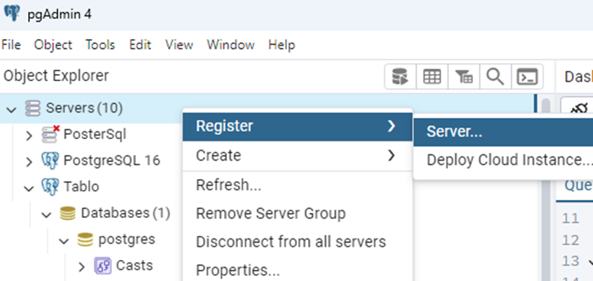
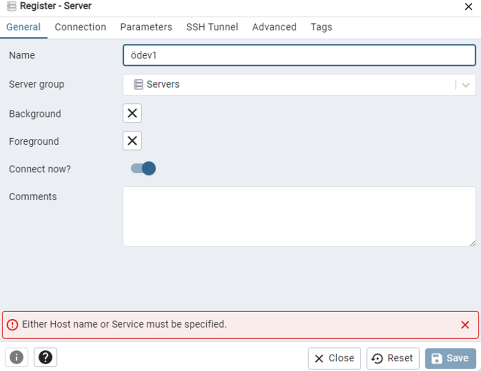
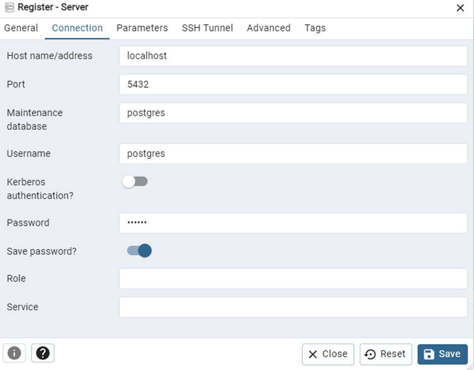
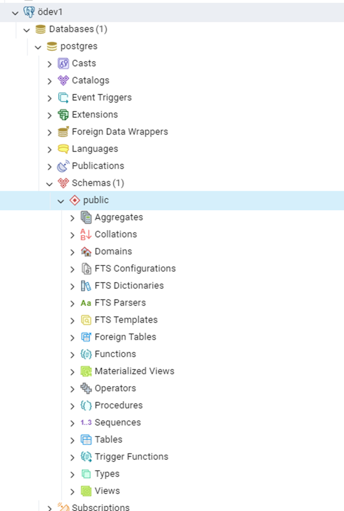
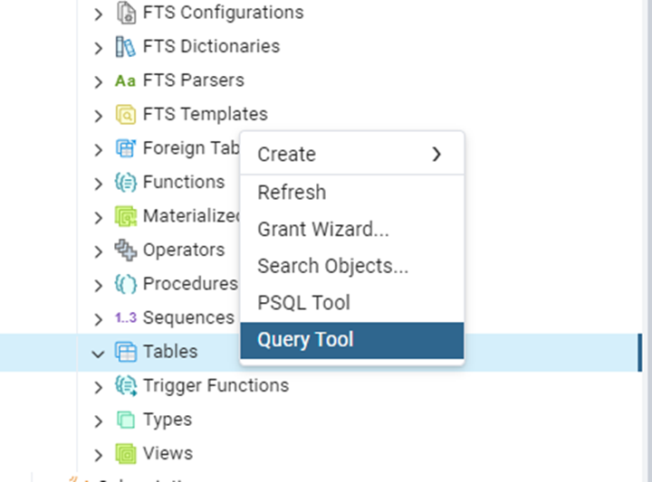
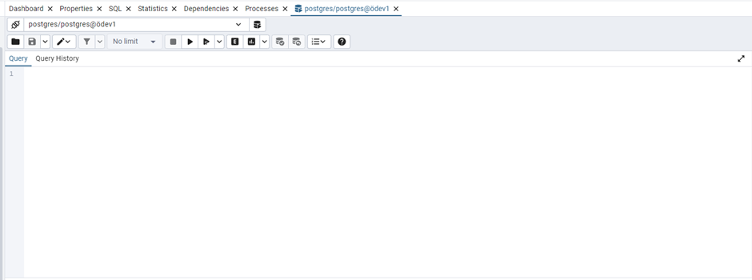
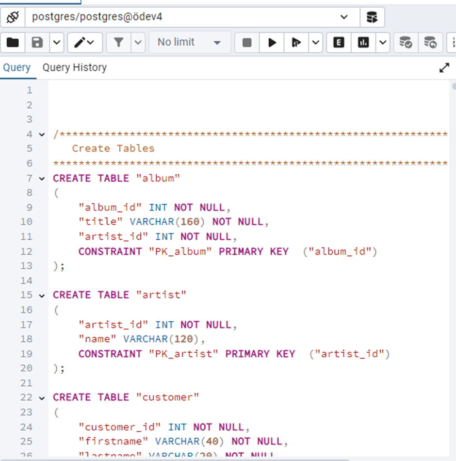

1. **Step:** First, right-click on “servers” and select “Register Server.”

2. **Step 2:** Next, enter the name of the server you want to create here.

3. **Step 3:** After completing the “General” tab, go to the “Connection” tab and enter **“localhost”** in the “Host Name” field. Next, enter the password you used during installation in the **“Password”** field and click “Save Password.” Once you’ve done this, click the “Save” button.

4. **Step 4:** Here, we open the database we created by selecting **“schemas,”** then right-click on “Tables” at the bottom.

5. **Step 5:** Click “**Query** Tool.”

6. **Step 6:** Click the file icon on the right and select the “hafta2.sql” file from the window that opens.   If you prefer, you can use the **“odev_csv_aktarma.sql”** file included in the folder to create only the table you’ll be using.

7. **Step 7:** Once the code appears, press the **F5** key to run it, and the tables will be created. Sometimes they may not appear immediately. You can hover over “Tables,” right-click, and select **“Refresh.”**